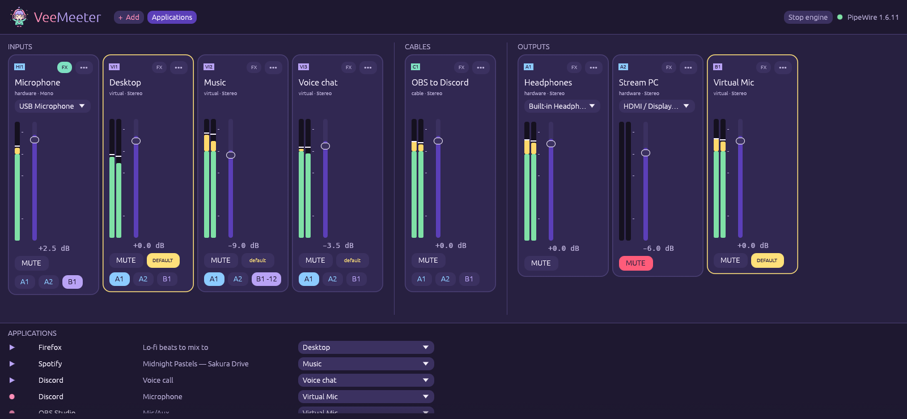
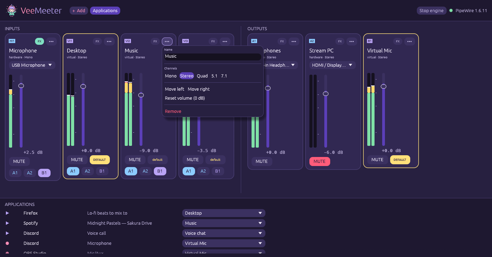
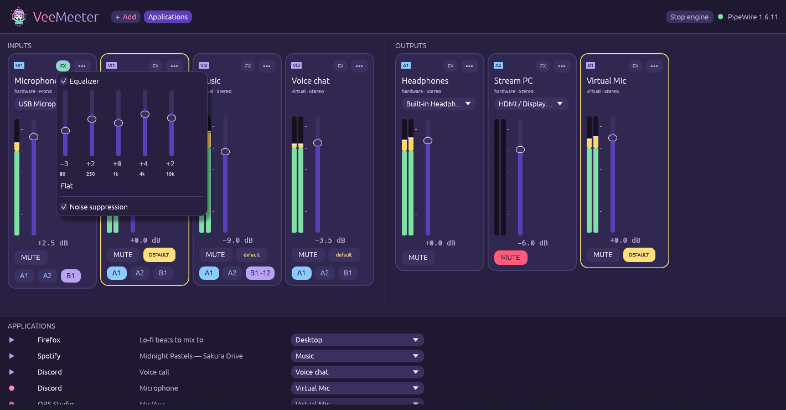
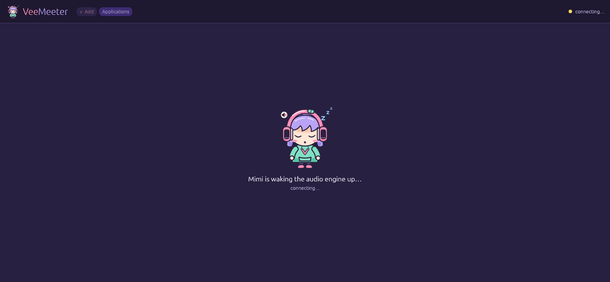
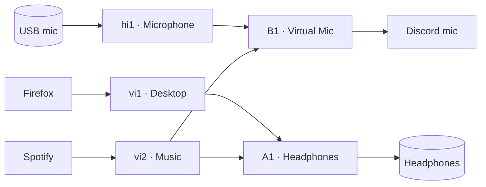

<div align="center">

<picture>
  <source media="(prefers-color-scheme: dark)" srcset="branding/logo/logo-horizontal-dark.svg">
  
</picture>

**A cute, native audio mixer and router for Linux — Voicemeeter vibes, PipeWire soul.**

Rust · PipeWire native · NixOS ready · no browser, no Electron

[Documentation](https://veemeter.v.bzh/) ·
[Install](#install) ·
[Guide](#5-minute-guide) ·
[CLI](#command-line) ·
[Brand kit](branding/README.md)

</div>


Hi, I'm **Mimi** (ミミ, *"ears"*), the little sound sprite who lives in your
PipeWire graph! My headphones show live VU meters and I *really* dislike
clipping. VeeMeeter is my mixing desk: mix your mic, your games, your music
and your calls, and send each of them exactly where it should go. (｡•̀ᴗ-)✧

VeeMeeter is a from-scratch Rust rewrite of
[PulseMeeter](https://github.com/theRealCarneiro/pulsemeeter): it talks to
**libpipewire directly**, keeps your routing alive in a small daemon, and
repairs the graph by itself when a device comes and goes.

<p align="center">
  
</p>

## Features

- 🎚️ **Strips like Voicemeeter** — hardware inputs (mics), virtual inputs
  (devices apps play into), hardware outputs **A1, A2…** and virtual outputs
  **B1, B2…** (virtual mics apps record from).
- 🔀 **One-click routing** — each input has an A/B button per output. Send
  your music to your headphones *and* to your stream, your voice only to
  Discord.
- 📊 **Real VU meters** — peak meters per channel at ~30 fps, measured with
  passive streams that never keep your devices awake, and only while a
  window is open.
- 🔊 **Faders in dB** (−∞ … +12 dB), mute, channel layouts (mono, stereo,
  quad, 5.1, 7.1).
- 🔌 **Virtual cables** — VB-Cable style: one app plays into *Cable*, another
  records from *Cable (output)*. Fader, VU meter and effects included.
- 🎚️ **Send levels** — right-click a route to set its own level: music at
  full volume in your headphones, −12 dB in your virtual mic.
- 🎛️ **Effects per strip** — 5-band equalizer (live, no reload) and RNNoise
  noise suppression, running inside the daemon with PipeWire's
  `filter-chain`.
- 🎯 **Move applications** — Firefox to *Desktop*, Spotify to *Music*,
  Discord's microphone to *Virtual Mic*, from the window or the CLI.
- ⭐ **System default** — make a virtual input your default output and a
  virtual output your default microphone; desktop volume keys and
  pavucontrol move VeeMeeter's fader too.
- 🌙 **Tray icon** — Mimi dances in your system tray to whatever is playing;
  *Start on tray* to launch straight there.
- 🔌 **Self-healing graph** — the engine reconciles the wanted graph against
  the real one on every change: plug your USB headset back in and its routes
  come back by themselves.
- 🧼 **Leaves nothing behind** — every node and link belongs to the daemon;
  stop it and they all vanish from PipeWire.
- 🙈 **Your fader is not the system volume** — hardware strips go through an
  internal node hidden from pavucontrol and desktop menus, so VeeMeeter never
  fights your sound settings.
- ❄️ **NixOS ready** — flake with package, overlay, NixOS module and
  home-manager module, plus a hardened systemd user service.
- 🪶 **Light** — one 13 MB binary (engine, window and CLI), egui on OpenGL,
  no web runtime.

## Use cases

| You are… | Set it up like this |
|---|---|
| **A streamer** | Game + music on *Desktop* → A1 (headphones) **and** B1. Mic → B1 only. OBS records **B1**: viewers hear game, music and you; you hear everything but your own voice. |
| **On calls while gaming** | Game on *Desktop*, Discord on *Voice chat*, both → A1. Two faders: lower the game without touching your friends. |
| **Sharing music in a voice chat** | Spotify on *Music* → A1 + B1, mic → B1, and right-click B1 to send the music at −12 dB. Pick **Virtual Mic** as your microphone in Discord: friends hear you *and* the music, under your voice. |
| **A podcaster** | Two USB mics as two hardware inputs → B1. Record B1 in your DAW, monitor on A1. |
| **Switching speakers ↔ headset** | One output per device (A1 speakers, A2 headset). Toggle A1/A2 on an input to move it — no app settings to dig into. |
| **Piping one app into another** | Add a *Virtual cable* "OBS to Discord": OBS outputs to **OBS to Discord**, Discord uses **OBS to Discord (output)** as its microphone. |
| **Hosting a watch party** | Browser on *Desktop* → A1 + B1, so the movie goes out through your virtual mic in sync with your voice. |

## Install

### NixOS (flake)

```nix
# flake.nix
{
  inputs.veemeeter.url = "github:Kisakay/VeeMeeter";

  outputs = { nixpkgs, veemeeter, ... }: {
    nixosConfigurations.myhost = nixpkgs.lib.nixosSystem {
      modules = [
        veemeeter.nixosModules.default
        { programs.veemeeter.enable = true; }  # package + user service started with PipeWire
      ];
    };
  };
}
```

### home-manager

```nix
{
  imports = [ inputs.veemeeter.homeManagerModules.default ];
  services.veemeeter.enable = true;
}
```

### Debian, Ubuntu, Fedora, Arch

Grab the package for your distribution on the
[Releases page](https://github.com/Kisakay/VeeMeeter/releases) — every file
is listed in `SHA256SUMS`:

```sh
sudo apt install ./veemeeter_*debian13_amd64.deb    # Debian / Ubuntu (pick yours)
sudo dnf install ./veemeeter-*.fedora*.x86_64.rpm   # Fedora
sudo tar -xzf veemeeter-*-arch-x86_64.tar.gz -C /   # Arch Linux
```

### Try it without installing

```sh
nix run github:Kisakay/VeeMeeter
```

### From source (any distro)

You need Rust ≥ 1.85, the `libpipewire-0.3` headers, `clang` (for bindgen)
and `pkg-config`. With Nix, `nix develop` provides all of it.

```sh
git clone https://github.com/Kisakay/VeeMeeter && cd VeeMeeter
cargo build --release
./target/release/veemeeter
```

Noise suppression uses the RNNoise LADSPA plugin: install it from your
distribution or from
[noise-suppression-for-voice](https://github.com/werman/noise-suppression-for-voice/releases)
so that `librnnoise_ladspa.so` is in `/usr/lib/ladspa` (or `LADSPA_PATH`).
The Nix package already ships it.

See [CHANGELOG.md](CHANGELOG.md) for what changed in each release.

## 5 minute guide


1. **Open VeeMeeter.** It starts its engine if needed. The first launch
   creates a ready-to-use desk: your mic, *Desktop* and *Voice chat* virtual
   inputs, your speakers as **A1** and a **Virtual Mic** as **B1**.
   *Desktop* becomes your default output, so apps already play through it.
2. **Pick your devices** in the drop-down of each hardware strip (mic, A1).
3. **Route**: on each input, light the outputs it should reach
   (A1 = what you hear, B1 = what your virtual mic sends).
4. **Move apps** in the *Applications* panel, e.g. Discord's playback to
   *Voice chat*. Optional: open **FX** on your mic for noise suppression and
   a touch of EQ.
5. **In Discord / OBS / your browser**, choose **Virtual Mic** as the
   microphone. Done — balance everything with the faders. ♪

Closing the window does **not** stop the audio: the daemon keeps routing.
Use **Stop engine** (or `veemeeter ctl quit`) to remove every VeeMeeter
device. Everything is saved in `~/.config/veemeeter/config.toml`.

<p align="center">
  
  
</p>

<p align="center">
  
</p>

## Command line

`veemeeter ctl` drives the running daemon — handy for keyboard shortcuts and
status bars.

```sh
veemeeter ctl status                # strips, routes, devices, applications
veemeeter ctl volume vi1 up         # +3 dB (also: down, up 1.5)
veemeeter ctl volume vi1 -- -6      # absolute level in dB
veemeeter ctl mute hi1              # toggle the mic
veemeeter ctl route vi2 b1 on       # send Music to the virtual mic
veemeeter ctl default vi1           # make Desktop the system default output
veemeeter ctl add b "Stream Mix"    # new virtual output (B2, …) — `a` for A2, A3…
veemeeter ctl add c "OBS to Discord" # virtual cable between two apps
veemeeter ctl move 71 vi2           # move application stream 71 to Music
veemeeter ctl send vi2 b1 -- -12    # Music quieter in the virtual mic only
veemeeter ctl eq hi1 -- -3,1.5,0,3.5,2   # equalize the mic (80 Hz … 10 kHz)
veemeeter ctl denoise hi1 on        # RNNoise noise suppression
veemeeter ctl --json status         # machine-readable state
```

Full reference: [CLI](https://veemeter.v.bzh/cli/) ·
[configuration file](https://veemeter.v.bzh/configuration/).

## How it works



- `veemeeter daemon` owns one PipeWire node per strip
  (`support.null-audio-sink`) and every link between them. A single event
  loop applies registry events and commands, then **reconciles** the wanted
  graph against the real one — hotplug needs no special case.
- The window and `veemeeter ctl` are thin clients of
  `$XDG_RUNTIME_DIR/veemeeter.sock` (one JSON message per line).

## VeeMeeter and PulseMeeter

PulseMeeter is the project that inspired VeeMeeter. The main differences:

| | PulseMeeter | VeeMeeter |
|---|---|---|
| Language / UI | Python + GTK | Rust + egui (OpenGL) |
| How it drives PipeWire | runs `pw-cli`, `pw-link`, `pactl`… as subprocesses | libpipewire in process, no subprocess |
| Fader | the device's volume | its own gain, independent of system volume |
| Graph ownership | objects left in PipeWire, cleaned up by the app | owned by the daemon: they vanish with it |

## Roadmap

- 📦 More architectures (aarch64 packages) and distro repositories

Known limits today: VeeMeeter needs a PipeWire session manager
(WirePlumber), like any PipeWire desktop; a routed hardware output stays
awake while something is routed to it.

## Contributing

Bug reports and PRs are welcome — see the
[contributing guide](https://veemeter.v.bzh/contributing/).
`nix develop`, then `cargo test` and `cargo clippy`. Screenshots are
regenerated with `scripts/screenshots.sh` (the real window, demo data).

## License

[GPL-3.0-only](LICENSE). Mimi and the VeeMeeter brand assets are original
artwork from this repository — see the [brand kit](branding/README.md).

<p align="center"></p>
