<p align="center">
  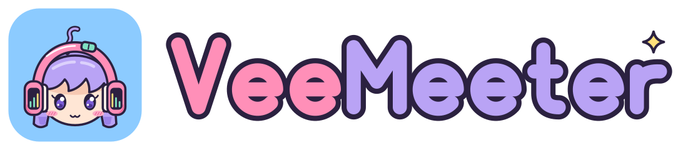
</p>

# VeeMeeter brand kit

Kawaii, anime-flavoured, **solid colours only**. Everything here is
hand-authored SVG: flat fills, thick round ink outlines, cel shading made of
flat darker shapes. **No gradients, no blur, no raster AI art.**

| Folder | Contents |
|---|---|
| `mascot/` | Mimi in 6 poses + 3 die-cut stickers |
| `logo/` | App icon / mark (colour, dark, small, mono), wordmarks, lockups, `png/` exports |
| `decor/` | Sparkles, star, heart, note, sound wave, meter bars, mute badge, pattern tiles, dividers |
| `social/` | 1280×640 social preview (`banner.svg` + `banner.png`), mixer mockup |
| `palette.toml` | The palette, including the egui `[ui.dark]` / `[ui.light]` themes |
| `palette.css` | Same palette as CSS custom properties (generated) |
| `favicon.svg` | 32-grid favicon |
| `swatches/` | Colour chips used by this README (generated) |
| `src/` | Generators. Edit these, then run `src/build.sh` |

`assets/veemeeter.svg` (installed as the hicolor app icon) is the same
artwork as `logo/mark.svg`, written by `src/logo.py`.

## Mascot: Mimi

<p>
  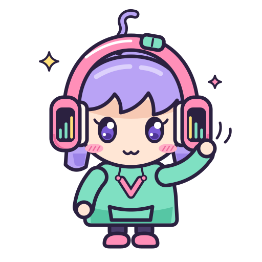
  
  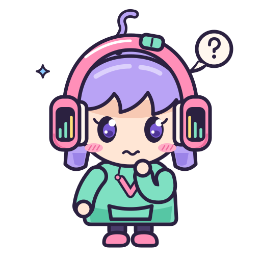
  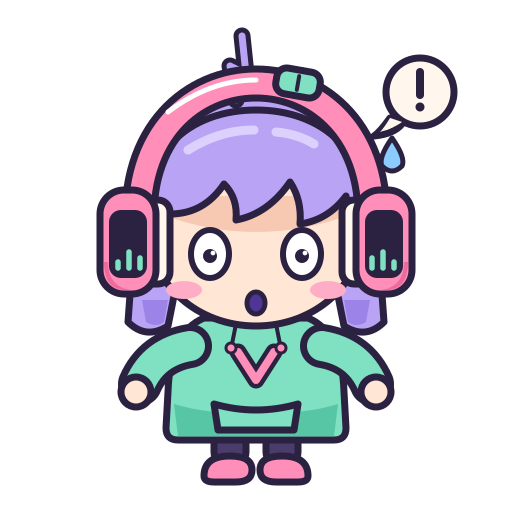
  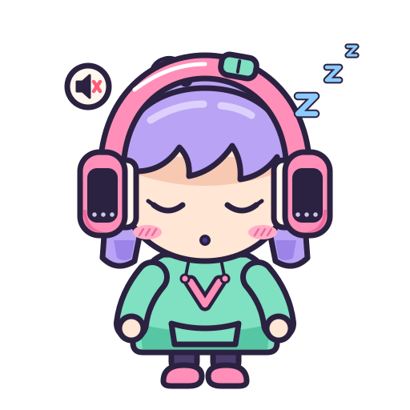
</p>

**Mimi** (ミミ, "ears") is a tiny sound sprite who lives inside your
PipeWire graph. She was born the first time someone routed a microphone into
a virtual cable and said "can you hear me now?". Her headphones are her
meters: the little bars on each ear cup bounce with whatever she is
listening to, and the mint knob on her headband is a fader she fiddles with
when she is nervous. Her lavender ahoge wiggles like a sound wave and droops
flat when a strip is muted. She is precise, a bit of a perfectionist about
gain staging, and she really, *really* hates clipping.

**Design notes**

- Chibi proportions: head ≈ 60 % of the height, stubby limbs, big eyes.
- Signature shapes: pink headphones with VU-bar ear cups, mint fader knob on
  the band, sound-wave ahoge, mint hoodie with a pink **V** chevron.
- Outline: ink `#2B2140`, 7 px at the 512 px master size, round joins.
- Cel shading: one flat darker tone per material (hair, headphones, hoodie,
  skin under the bangs). Never a gradient.

| Pose | File | Use it for |
|---|---|---|
| Waving | `mimi-wave.svg` | Hello, home page, default |
| Cheering, meters peaking | `mimi-happy.svg` | Success, releases, "it works!" |
| Sleepy, muted | `mimi-sleepy.svg` | Mute, empty states, idle |
| Surprised | `mimi-surprised.svg` | Errors, 404, warnings |
| Thinking | `mimi-thinking.svg` | FAQ, tips, "did you know" |
| Winking | `mimi-wink.svg` | Playful asides |
| Stickers | `mimi-*-sticker.svg` | Social posts, merch, coloured backgrounds |

The VU bars on her ear cups follow the pose: idle (green-green-yellow),
peaking (green-yellow-red), muted (all grey).

Mimi is an original character made for VeeMeeter. Keep her that way: don't
redraw her as, or next to, characters from other franchises.

## Logo

<p>
  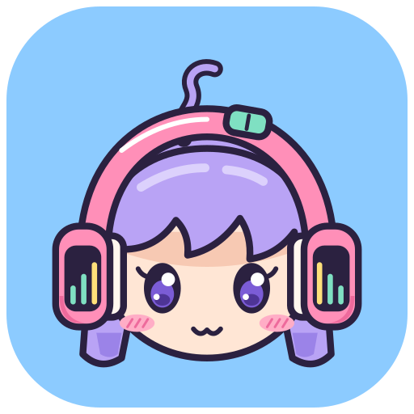
  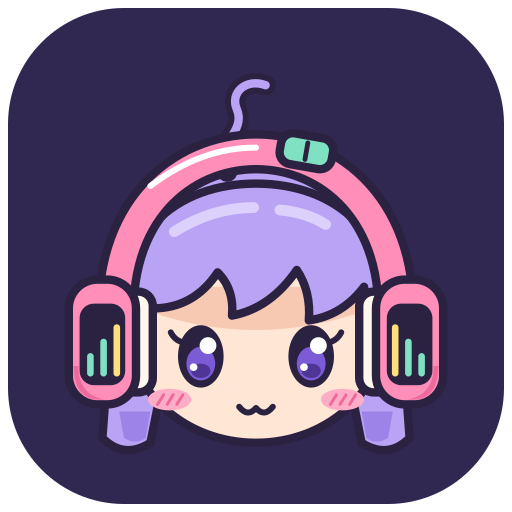
  
  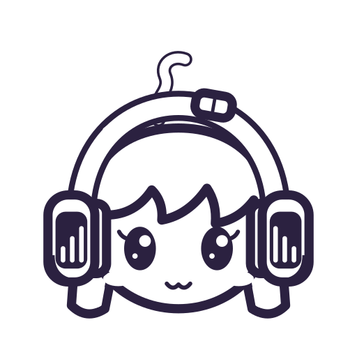
  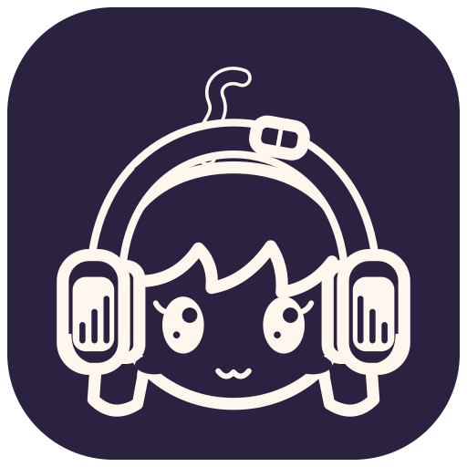
</p>

| File | Use |
|---|---|
| `logo/mark.svg` | App icon / avatar, sky tile. ≥ 64 px. |
| `logo/mark-dark.svg` | Same on a dark card tile, for dark pages. |
| `logo/mark-small.svg`, `favicon.svg` | Pixel-hinted 32-grid version for **16–48 px** (favicon, tray, menus). |
| `logo/mark-mono.svg`, `logo/mark-mono-inverse.svg` | One ink colour: print, embossing, single-colour contexts. |
| `logo/wordmark.svg` | Bubble lettering on light backgrounds. |
| `logo/wordmark-dark.svg` | With a cream halo, for dark backgrounds. |
| `logo/wordmark-mono.svg`, `wordmark-mono-white.svg` | Single colour. |
| `logo/logo-horizontal.svg`, `-dark.svg` | Mark + wordmark lockup (default logo). |
| `logo/logo-stacked.svg` | Mark above wordmark, for square spaces. |
| `logo/png/veemeeter-{16,32,48,256,512}.png` | Raster exports. |

The wordmark is drawn with strokes, not set in a font: "**Vee**" in sakura,
"**Meeter**" in lavender, merged ink outline, one lemon sparkle.

**Clear space**: keep at least the height of the wordmark's lowercase "e"
(≈ ¼ of the mark's width) empty on every side.

**Minimum sizes**: mark 16 px (use `mark-small`), full-detail mark 64 px,
horizontal lockup 160 px wide, wordmark alone 96 px wide.

**Do**

- Use the files as they are, on cream, white, the brand solids or `#1E1830`.
- Use the `-dark` variants on dark backgrounds.
- Use the mono variants when you only have one colour.

**Don't**

- Add gradients, glows, drop shadows with blur, or bevels.
- Recolour Mimi or the wordmark outside the palette, or swap Vee/Meeter colours.
- Stretch, rotate, outline, or re-typeset the wordmark in a font.
- Put the colour logo on busy photos or on sakura/lavender (it disappears).

## Palette

Solid colours only. Source of truth: [`palette.toml`](palette.toml)
(CSS: [`palette.css`](palette.css)).

| | Name | Hex | Role |
|---|---|---|---|
|  | sakura | `#FF8FB8` | Primary pink, buttons, headphones |
|  | sakura_deep | `#C2185B` | Pink **text** on light |
|  | lavender | `#B9A3F5` | Secondary, hair, B buses |
|  | lavender_deep | `#5B3FB8` | Lavender **text**/links on light |
|  | lavender_pale | `#DCD1FC` | Soft panels, highlights |
|  | mint | `#7FE0C2` | Success, "on", hoodie |
|  | mint_deep | `#1E7A5E` | Mint **text** on light |
|  | sky | `#8CCBFF` | Info, A buses, icon tile |
|  | lemon | `#FFE07A` | Highlights, sparkles, default star |
|  | cream | `#FFF7EE` | Light background |
|  | ink | `#2B2140` | Text, outlines |
|  | ink_soft | `#5A4E78` | Muted text on light |
|  | night | `#1E1830` | Dark background |
|  | cherry | `#FF5C7A` | Mute, errors |

### Accessible pairings (WCAG 2.x)

Checked by `src/palette.py` (it fails if a ratio in `palette.toml` is wrong).

| Text | Background | Ratio | Level |
|---|---|---|---|
| ink `#2B2140` | cream `#FFF7EE` | 14.19 : 1 | AAA |
| ink_soft `#5A4E78` | cream | 7.08 : 1 | AAA |
| sakura_deep `#C2185B` | cream | 5.54 : 1 | AA |
| lavender_deep `#5B3FB8` | cream | 6.95 : 1 | AA |
| mint_deep `#1E7A5E` | cream | 4.95 : 1 | AA |
| ink | sakura `#FF8FB8` | 7.08 : 1 | AAA |
| ink | lavender `#B9A3F5` | 6.90 : 1 | AA |
| ink | mint `#7FE0C2` | 9.57 : 1 | AAA |
| ink | sky `#8CCBFF` | 8.68 : 1 | AAA |
| ink | lemon `#FFE07A` | 11.62 : 1 | AAA |
| ui.dark.text `#F7F1FF` | ui.dark.bg `#1E1830` | 15.45 : 1 | AAA |
| ui.dark.text | ui.dark.card `#312852` | 12.20 : 1 | AAA |
| ui.dark.text_muted `#B8ADD6` | ui.dark.bg | 8.13 : 1 | AAA |
| ui.dark.text_muted | ui.dark.card | 6.42 : 1 | AA |
| ui.dark.accent `#FF8FB8` | ui.dark.card | 6.35 : 1 | AA |
| ui.dark.mute `#FF5C7A` | ui.dark.bg | 5.75 : 1 | AA |
| ink (text_on_accent) | ui.dark.mute | 5.07 : 1 | AA |

Rules: pastel solids (sakura, lavender, mint, sky, lemon) are **fills**; text
on them is always **ink**. On light backgrounds, coloured text uses the
`_deep` variants. Never put white text on a pastel.

### App theme (egui)

`[ui.dark]` (default) and `[ui.light]` in `palette.toml` are meant to be read
by the GUI as-is: `bg`, `panel`, `card`, `card_hover`, `border`, `selection`,
`text`, `text_muted`, `text_on_accent`, `accent`, `accent_2`, `accent_3`,
`bus_a`, `bus_b`, `default_star`, `meter_bg`, `meter_green`, `meter_yellow`,
`meter_red`, `mute`, `success`, `warning`, `error`.

Meters: green below −12 dBFS, yellow −12 … −3, red above −3 / clip.

## Typography

All free on Google Fonts.

| Role | Font | Notes |
|---|---|---|
| Display / headings | **Fredoka** (500–700) | Rounded, friendly, very readable. |
| Body / UI | **Nunito** (400–800) | Rounded terminals, matches the wordmark. |
| Code / CLI | **JetBrains Mono** | Clear `0/O`, `1/l`. |

The logo never uses a font: the wordmark is vector lettering.

## Decorations

<p>
  
  
  
  
  
  
  
  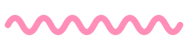
</p>


`pattern-light.svg` / `pattern-dark.svg` are seamless 160 px tiles (quiet,
outline-free motifs) for backgrounds. Use decorations sparingly: one or two
sparkles near a heading, never behind body text.

## Social preview

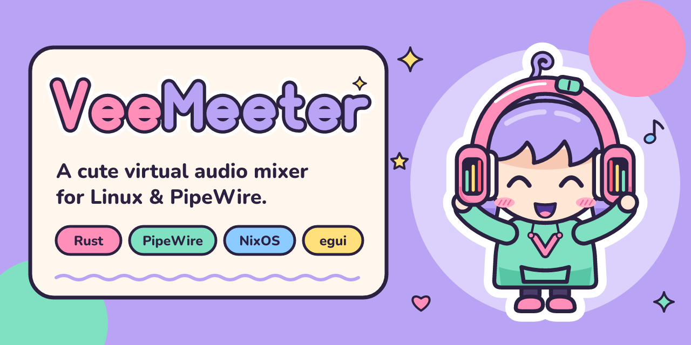

Upload `social/banner.png` in GitHub › Settings › Social preview.

## Tone of voice

- **Playful, kawaii, but technically precise.** The facts come first; the
  cute is the seasoning.
- Short sentences, active voice, real commands you can copy.
- Mimi may speak in admonitions ("Mimi says…"), never in reference tables.
- Kaomoji and emoji in moderation: at most one per section, never in error
  messages or CLI output. Good: (｡•̀ᴗ-)✧ ٩(◕‿◕)۶ (⊙_⊙;) ✨ 🎧
- Say "virtual input" / "virtual output" / "A bus" / "B bus" consistently.

## Regenerating

```sh
branding/src/build.sh     # SVGs, palette check + palette.css, PNG exports
```

The PNG step uses `nix` for `resvg` and the Nunito font; SVG generation only
needs Python 3.11+.

---

Artwork © VeeMeeter contributors, distributed with the project under
GPL-3.0-only.
