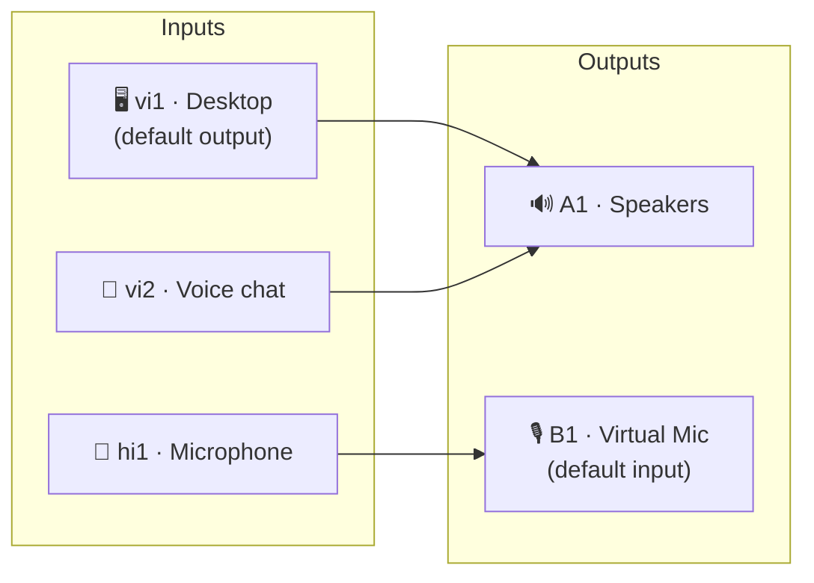
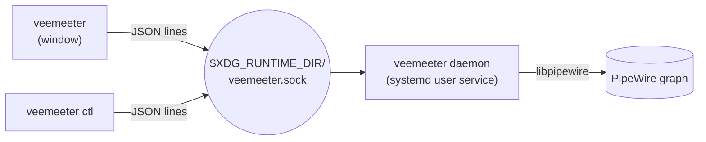

# Getting started

VeeMeeter borrows Voicemeeter's vocabulary. Once you know four words
(**input**, **output**, **A bus**, **B bus**) the whole window makes sense.

## Strips

Every column in the mixer is a **strip**. There are four kinds:

| Kind | Id | What it is | Example |
|---|---|---|---|
| Hardware input | `hi1`, `hi2`… | A real capture device. | Your USB microphone |
| Virtual input | `vi1`, `vi2`… | A virtual **output device** that applications play into. | *Desktop*, *Voice chat* |
| Hardware output | `a1`, `a2`… | A real playback device: an **A** bus. | Speakers, headset |
| Virtual output | `b1`, `b2`… | A virtual **microphone** that applications record from: a **B** bus. | *Virtual Mic* for Discord |

!!! note "Virtual input = a fake speaker, virtual output = a fake mic"
    The naming follows the mixer's point of view: sound **comes in** through
    a virtual input (apps think it is a speaker) and **goes out** through a
    virtual output (apps think it is a microphone).

Hardware inputs are wrapped in an internal, hidden node. Moving the fader of
`hi1` changes VeeMeeter's gain, never your system microphone volume.

## Routing

Each **input** has one toggle button per **output** (`A1`, `A2`, `B1`…).
Turn a button on and that input is mixed into that output. An input can feed
any number of outputs, and an output sums every input routed to it.

The default first-run setup looks like this:

- Apps play into **Desktop** by default (it carries the default-device star),
  and you hear it on **A1**.
- Point your voice app's output at **Voice chat** to give calls their own fader.
- Your microphone goes to **B1**; select *Virtual Mic* as the microphone in
  Discord, OBS, etc.

## Classic recipes

??? example "Let your friends hear your music"
    Turn on `B1` on the **Desktop** strip. Desktop audio is now mixed into the
    virtual mic, together with your microphone. Lower Desktop's fader so your
    voice stays on top.

??? example "Stream audio without the call"
    Add a second virtual output (`veemeeter ctl add b Stream`), route
    Microphone and Desktop to it but **not** Voice chat, and select it as the
    audio source in OBS.

??? example "Headset and speakers at once"
    Add a hardware output for the headset
    (`veemeeter ctl add a Headset --device <node name>`), then toggle `A2` on
    the inputs you want there.

## Levels

- Faders are in **dB**: `0 dB` is unity, `-60 dB` means off, up to `+12 dB` of boost.
- **Mute** silences a strip without losing its fader position.
- VU meters show the **peak** level per channel.
- Strips can be **mono, stereo, quad, 5.1 or 7.1**.

## The default device star

Virtual strips can carry a star: the starred virtual input is the system
**default output**, the starred virtual output is the system **default input**.
Volume keys and pavucontrol stay in sync with the starred virtual input's
fader, in both directions.

## Daemon and window

The **daemon** owns every node and link. The window and `ctl` are just
remote controls, so closing the window never cuts your audio. When the
daemon stops, all of its nodes and links disappear cleanly.

!!! mimi "Next steps"
    Learn the window in the [GUI guide](gui.md), script it with the
    [CLI](cli.md), or tweak [`config.toml`](configuration.md) by hand.
