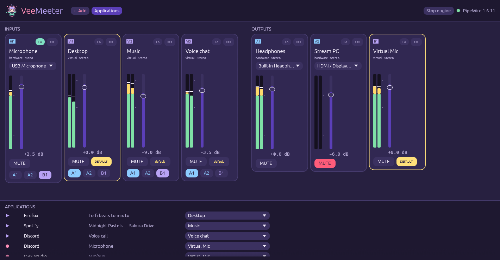
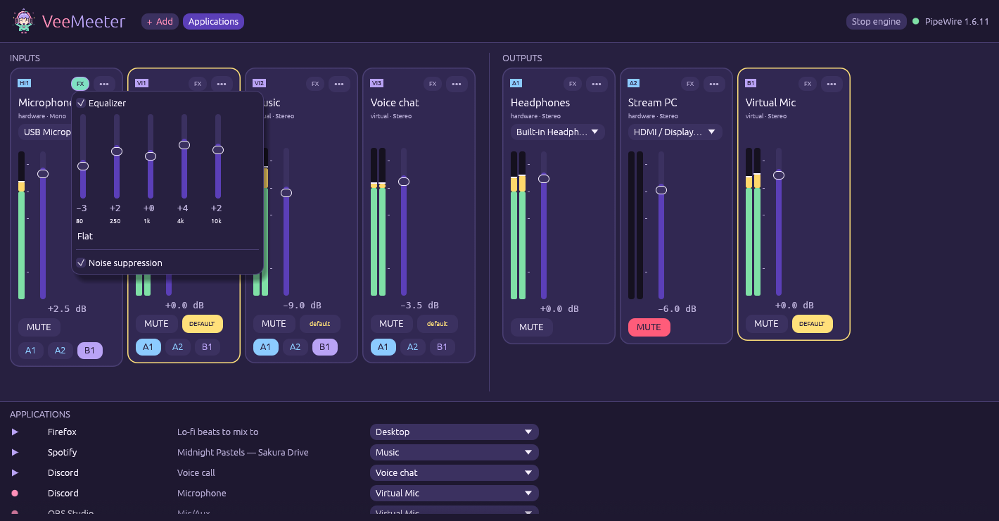

# GUI guide

Run `veemeeter` (or `veemeeter gui`). If the daemon is not running yet, the
window starts it and shows a sleepy Mimi (*Mimi is waking the audio engine up…*) for a moment. Use
`veemeeter gui --no-spawn` if you never want the window to start the engine.

{ .vm-shot loading=lazy }

!!! note "The window is still evolving"
    Labels and layout may move a little between releases. The behaviour
    described here (what each control does) is stable.

## Top bar

| Control | What it does |
|---|---|
| **+ Add** | Adds a strip: *Hardware input*, *Virtual input*, *Hardware output* or *Virtual output*. Hardware strips pick the first device not used yet. |
| **Applications** | Shows the applications panel (see below). |
| **Stop engine** | Stops the daemon. Every VeeMeeter device disappears until it is started again. |
| Status dot | Green with the PipeWire version when connected; otherwise the connection status. |

## A strip

The mixer has an **INPUTS** row and an **OUTPUTS** row. Every strip card has:

Fader
:   Volume in dB, from −60 (off) to +12. **Drag**, **scroll** over it, or
    **double-click** to go back to 0 dB.

VU meter
:   Peak level per channel.

**MUTE**
:   Silences the strip; the fader position is kept.

**A1 / A2 / B1 …** *(inputs only)*
:   One button per output. Lit = this input is sent to that output.
    Hover a button to see the output's name.

**default** *(virtual strips only)*
:   Makes the strip the system default: a virtual input becomes the default
    **output** (apps play there), a virtual output becomes the default
    **microphone**. The starred strip shows **DEFAULT**.

Device picker *(hardware strips only)*
:   Chooses the real device. An unplugged device shows *(unplugged)*; the strip
    reconnects by itself when it comes back.

**•••** menu
:   Rename, channel layout (*Mono*, *Stereo*, *Quad*, *5.1*, *7.1*, or
    *Match device*), move the strip left/right, *Reset volume (0 dB)*, *Remove*.

## Effects (FX)

{ .vm-shot loading=lazy }

The **FX** button of a strip lights up (mint) when an effect is on. It opens:

- **Equalizer** — five bands (80 Hz, 250 Hz, 1 kHz, 4 kHz, 10 kHz),
  −12 … +12 dB. Changes are heard live; double-click a band for 0 dB,
  **Flat** resets them all.
- **Noise suppression** — RNNoise removes fans, keyboard clicks and hum from
  a voice. Greyed out until the RNNoise LADSPA plugin is installed (the Nix
  package ships it).

Turning an effect on or off reloads the effect chain of that strip (a very
short gap); moving a band never does.

## Applications panel

Lists every stream that is playing (▶) or recording (●), with the strip or
device it currently uses. Pick another target in its drop-down to move it:
playing apps can go to any virtual input, recording apps to any virtual
output, or both straight to a real device.

!!! mimi-sleepy "Empty panel?"
    *No application is playing or recording right now*: start some audio and
    it shows up instantly, no refresh needed.

## Desktop integration

- The starred virtual input follows your **volume keys** and **pavucontrol**,
  and the other way round: moving the fader updates the desktop volume.
- Hardware inputs are wrapped in a hidden internal node, so VeeMeeter's
  microphone fader never changes your system microphone volume.
- Closing the window keeps the routing alive: the daemon does the audio.
