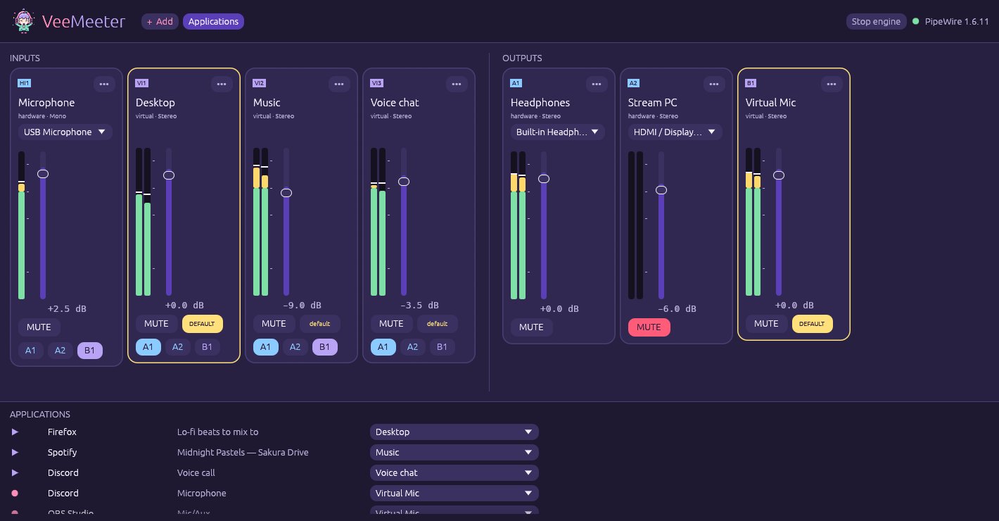

<div class="vm-hero" markdown>

<div markdown>

<h1 class="vm-sr">VeeMeeter</h1>


<p class="vm-tagline">A cute, native virtual audio mixer and router for Linux. Voicemeeter-style strips and A/B buses, built directly on PipeWire.</p>

<p class="vm-pills"><span>Rust</span> <span>PipeWire native</span> <span>NixOS ready</span> <span>egui</span></p>

[Install it :material-download:](installation.md){ .md-button .md-button--primary }
[How it works :material-book-open-variant:](concepts.md){ .md-button }

</div>


</div>

## What you get

<div class="grid cards" markdown>

-   :material-tune-vertical:{ .lg .middle .vm-c1 } __Strips and buses__

    ---

    Hardware and virtual **inputs**, hardware (**A**) and virtual (**B**) **outputs**.
    Route any input to any set of outputs with one click.

-   :material-lightning-bolt:{ .lg .middle .vm-c2 } __Native PipeWire__

    ---

    Talks to `libpipewire` directly. No `pactl` / `pw-cli` subprocesses,
    no polling, no browser, no Electron.

-   :material-heart-pulse:{ .lg .middle .vm-c3 } __Always on__

    ---

    A small daemon owns the audio graph, so routing stays alive when the
    window is closed. Stop it and every VeeMeeter node vanishes cleanly.

-   :material-usb-port:{ .lg .middle .vm-c1 } __Hotplug that heals__

    ---

    Nodes and links are reconciled declaratively: unplug your headset,
    plug it back, and the routes come back on their own.

-   :material-volume-high:{ .lg .middle .vm-c2 } __Real mixer controls__

    ---

    Faders in dB (−60 = off … +12), mute, peak VU meters, mono to 7.1 layouts,
    default-device star, two-way sync with your desktop volume keys.

-   :material-snowflake:{ .lg .middle .vm-c3 } __NixOS first__

    ---

    A flake with a package, an overlay, a NixOS module and a home-manager
    module. `nix run github:Kisakay/VeeMeeter` and you are mixing.

</div>

## A peek at the mixer

<figure markdown>
  { .vm-shot loading=lazy }
  <figcaption>The mixer: inputs on the left, outputs on the right, applications at the bottom.</figcaption>
</figure>

## Try it in one line

```sh
nix run github:Kisakay/VeeMeeter
```

The window starts the daemon for you. For a permanent setup (daemon as a
systemd user service), see [Installation](installation.md).

!!! mimi "Hi, I'm Mimi!"
    I live inside your PipeWire graph and keep an ear on every strip.
    New here? Read [Getting started](concepts.md) first: inputs, outputs and
    the A/B buses take two minutes to click (｡•̀ᴗ-)✧


